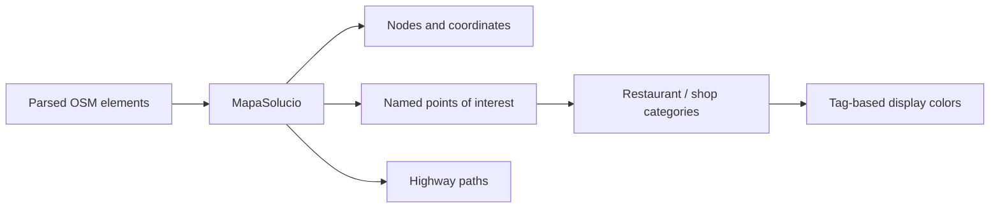

# OpenStreetMap Map Processing in C++

**C++17 · Object-oriented programming · Geographic data · XML-based map structures**

A **completed university team assignment** from **Laboratori de Programació** at the Universitat Autònoma de Barcelona (UAB). Working from an instructor-provided project structure, our team implemented the C++ map-domain logic for OpenStreetMap data: extracting points of interest and street paths, organizing coordinates, and applying tag-based classification and visualization rules.

> **Portfolio scope:** This repository presents the team's completed OpenStreetMap **map-processing assignment** as a portable, source-only edition. The instructor-provided Windows graphical environment is not redistributed, and the portfolio edition does not offer a route-planning application.

## How it works



The instructor-provided university framework handled XML import and a Windows WPF map visualization. **This public portfolio edition contains the portable C++ model layer** and an independently runnable example, not the original GUI or bundled third-party library.

## Implemented in the team submission

- **Coordinate indexing:** match OSM node identifiers to latitude and longitude.
- **POI extraction:** detect named restaurants and shops from OSM tags.
- **POI styling:** choose colors according to attributes such as cuisine, shop type, opening hours, or wheelchair access.
- **Path extraction:** turn `way` elements tagged as `highway` into ordered coordinate sequences.
- **Model lifecycle:** retrieve the discovered POIs and ways and reset the map when parsing another set of elements.

The class interfaces and integration framework were provided by the instructor. The student-developed `*Solucio.*` files reflect the team's work on the assignment; **individual responsibilities were not documented in the submitted ZIP**, so I do not attribute every change to myself. See [attribution](docs/attribution.md).

## Run the portable example

Requires a C++17 compiler and CMake 3.16 or later. No downloaded datasets, Windows SDK, or external libraries are required for this subset.

```bash
cmake -S . -B build
cmake --build build
```

On Linux/macOS:

```bash
./build/osm_example
```

On Windows with a multi-configuration generator, the executable is typically `build\Debug\osm_example.exe`.

Example output (using **synthetic**, not real map data):

```text
Points of interest: 2
- Example Restaurant (41.387, 2.169) color=0x7fffd4
- Example Market (41.388, 2.17) color=0xdfff00
Paths: 1
- path with 3 coordinates
```

## Tests

```bash
ctest --test-dir build --output-on-failure
```

The **seven independent checks**, added for the portfolio rather than supplied by the university, cover OSM tag lookups, POI extraction, restaurant/shop colors, highway paths, resetting the map, and a Haversine-distance utility. See [`tests/test_map.cpp`](tests/test_map.cpp).

## Repository structure

```text
src/                       Original C++ map model and required scaffold
examples/example.cpp       Synthetic, reproducible console example
tests/test_map.cpp         Seven independent checks (single test executable)
docs/attribution.md        Origin of the framework and team work
docs/limitations.md        Scope, assumptions, and omitted components
.github/workflows/test.yml  Automated portable build and tests
CMakeLists.txt              Portable build configuration
```

## Design decisions and limitations

- Works on `XmlElement` objects **already parsed** by the original university infrastructure; does not directly read `.osm` files in this release.
- Supports a limited set of tag categories. It is not a full OpenStreetMap data model.
- The original Windows starter code contained a `shortestPath` placeholder marked `DO NOT TOUCH`, alongside a UI comment identifying shortest-path support as a "2nd part". Its presence does **not** establish that the submitted map-processing assignment was unfinished.
- The Windows WPF map renderer, DLL bridge, and bundled Xerces-C++ library have been excluded from this shareable source-only subset.

See the [technical limitations](docs/limitations.md) for more detail.

## Academic context

**Course:** Laboratori de Programació · **Degree:** Computer Engineering · **Institution:** UAB · **Type:** team project.

This portfolio version is intended to showcase the **C++ logic built on top of a teaching scaffold**, rather than claim ownership of the university's graphical tools or third-party dependencies. Publication of course/team code should be agreed with the relevant authors.
